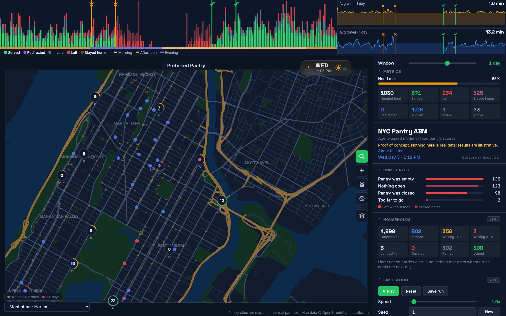
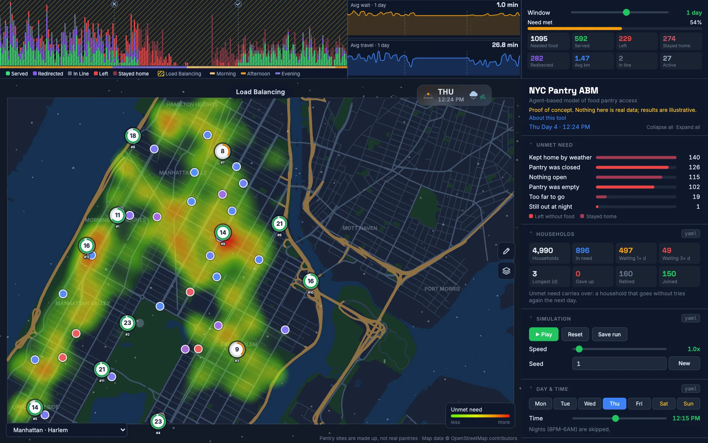
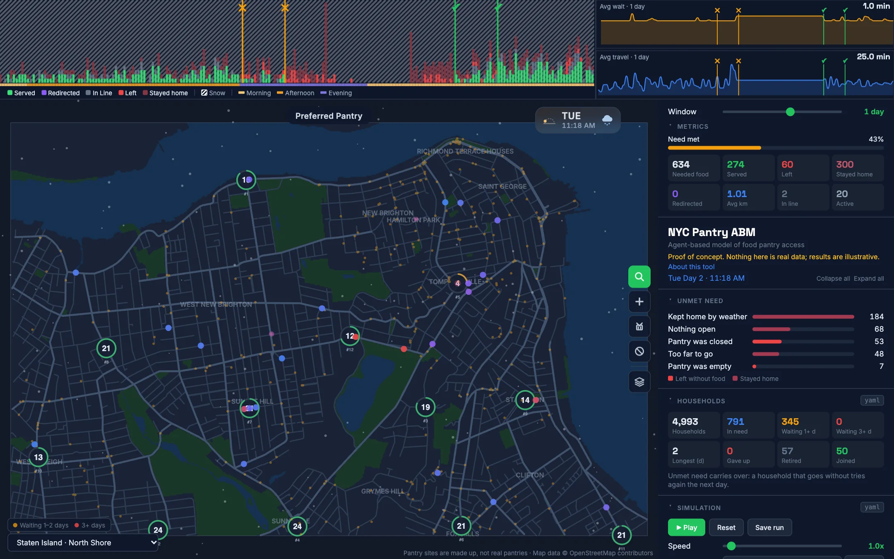
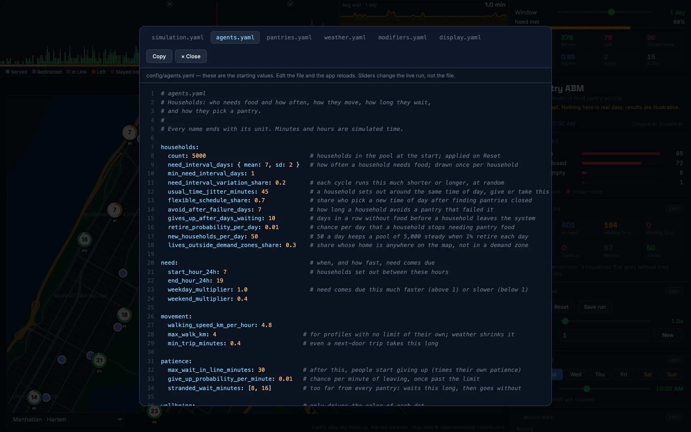

# NYC Pantry ABM

An agent-based simulation of people looking for food at neighborhood pantries in New York City. Pantries open and close, run out of food, and restock. People walk real streets to reach them, wait in line, and sometimes give up. You can compare routing rules, demand shocks and weather, and export what happened.

The maps are real segments of the five boroughs, built from OpenStreetMap.

**Try it:** [jonathan-chin.github.io/pantry-abm](https://jonathan-chin.github.io/pantry-abm/)

**Status: proof of concept.** Apart from the street maps, nothing in it is real data yet. Pantries, households and their behavior are made up, and results are illustrative.



## Why this exists

This is a thought experiment that may grow into my dissertation.

The aim is a testbed for the emergency food system: a model good enough to try ideas on before trying them on people. It can be used to ask, for example:

- **Interventions.** Does steering people towards pantries that still have stock (load balancing, the first experiment built in) get more people fed? What about adding a pantry, changing hours, or restocking differently? And what does each cost people in extra travel and waiting?
- **Shocks.** What happens when demand jumps (a SNAP disruption, a holiday surge), when weather keeps people home or cuts their patience, or when a pantry closes?
- **Who is left out.** Where on the map does demand go unmet, and does a given change help those places or just the ones that were already served?

A scenario is a set of modifiers and pantry changes. Save a run with and without them, then compare the runs in the summary or the CSV export. New interventions and shocks are meant to be added as new modifiers.

It isn't calibrated to any real pantry network yet. Its numbers are for comparing scenarios with each other, not for predicting what would happen in the city.

## Running it

You need Node.js 20.19 or newer (22.12 or newer on the 22 line).

```bash
npm install
npm run dev        # http://localhost:5173
npm run build      # static site in dist/ (relative paths, so it works from any folder)
```

## What's on screen

The tool is designed for desktop and laptop screens, not phones.

- **Timeline (top left).** Stacked bars of people served, redirected, waiting in line, leaving without food, and staying home, per time slice. A faint pattern behind the bars shows which modifiers were on; each modifier has its own pattern and color. The thin strip along the bottom shows the time of day: morning, afternoon or evening. Click a legend item to hide that band.
- **Event markers.** A heavy line with a badge marks a shock, or a pantry you added, removed, closed or reopened. Quieter dashed lines mark the daily rhythm: a check where pantries start opening in the morning, a cross where they start closing in the evening.
- **Sparklines (top middle).** Average wait and average travel time, with the same event markers.
- **Numbers (top right).** The **Window** slider sets the time span for every chart and for these numbers, from 1 hour to the whole run. Below it are the share of need met and the counts for that window.
- **Map.** Pantries are the large white disks. The number is the food left, and the ring around it shows how full the shelves are; an empty pantry shows a red 0. A dark disk with a moon is closed for the night, and a dark disk with an X is one you closed by hand. The smaller dots with white rings are people on a trip. The color inside shows how they're doing, and it starts redder the longer their household has gone without. People in line gather around the pantry. Someone who is turned away walks a short way back along their street and fades. People too far from any pantry waggle in place and then time out.
- **Panel (right).** Controls and detail. Every section collapses.

### More screenshots

Load balancing on, with the unmet need heatmap: the areas where the most households went without food, from green to red. The pattern behind the timeline shows when the modifier was on.



A snow day on Staten Island's North Shore. Most unmet need comes from people kept home by the weather.



Every setting is in a YAML file, with the unit in its name. The `yaml` buttons open them in the tool.



### What the numbers mean

Each day, every household whose need is due makes one trip. Each trip ends in one of three ways:

- **Served.** They got food.
- **Left.** They set out and came back without it: the pantry was empty or closed, the line was too long, or night fell.
- **Stayed home.** They needed food but never set out: the weather kept them in, nothing was open when they were free, or every pantry was too far.

**Need met** is served divided by everyone who needed food that day. People who stay home count against it, so a snowy day can't look better just because fewer people showed up. A household that goes without counts again the next day, because its need carries over. The **Unmet need** section of the panel shows how many went without for each reason.

The **Households** section shows the pool: how many are in need, how many have waited 1 or 3 days or more, and how many have given up, retired or joined.

### Map tools

Two buttons sit on the right edge of the map.

**Pantry tools** opens a menu to add a pantry, remove one, or close and reopen one. Choose a tool, then click the map. The button turns green while a tool is on, and Escape puts it away. With no tool on, clicking a pantry inspects it.

**Layers** switches optional layers on and off. For now there is one, the unmet need heatmap. The base map, pantries, people and weather effects are always drawn.

The **unmet need heatmap** shows where the households that went without food live, counted since the start of the run. Nearby areas merge into smooth patches that run from green through yellow to red. The scale is relative to the run: red is the worst area in this run, and areas with little unmet need are left clear. It shows where the gaps are, not how large they are compared with another run.

### Controls

| Section | What it does |
| --- | --- |
| Simulation | Play, pause, reset, save a run, speed, seed |
| Day and time | Jump to any weekday and time between 6 AM and 8 PM (nights are skipped) |
| Modifiers | Routing (load balancing), demand (holiday surge), weather (rain, snow, heat wave, high wind) |
| Environment | Number of pantries and capacity (applied on Reset), service speed, and the SNAP shock button |
| Agents | Number of households, and how much capacity varies between pantries (both applied on Reset) |
| Data | Summary of saved runs and CSV export |

**Seed.** The seed fixes every random choice in a run: which pantry sites are used, the weather, who appears where, and what they decide. The same seed with the same settings replays the same run, on any machine. The tool picks a new random seed each time it loads and shows it in the Seed box, so note it down if you want to replay a run. Type a seed or press New, then Reset. To always start from the same seed, set `initial_seed` in `config/simulation.yaml` to a number. Two scenarios run on the same seed get the same pantries, weather and arrivals, so differences between them come from the scenario and not from luck.

### Settings

Every setting lives in a YAML file in `config/`, and every name ends with its unit (`walking_speed_km_per_hour`, `max_wait_in_line_minutes`, `capacity_packages`).

| File | What it holds |
| --- | --- |
| `simulation.yaml` | Clock, speed, step size, seed, chart sampling |
| `agents.yaml` | Households (pool size, how often they need food, memory, giving up, turnover), walking, patience, profiles, how a pantry is chosen |
| `pantries.yaml` | Count, capacity, service rate, hours, restocking, the shock |
| `weather.yaml` | Daily weather odds and what each condition does to people |
| `modifiers.yaml` | The modifier toggles, with the color and pattern each one draws behind the timeline. A new `additive` entry with a `need_multiplier` works without code |
| `display.yaml` | How things are drawn. Nothing here changes results |

The files are the starting values. Edit one and the app reloads; a bad value stops the app with a message naming the file and the setting. Sliders change the live run, not the files. Sections with a `yaml` button show the file they belong to.

Times in the files are simulated minutes and hours. `src/config.js` converts them once into the engine's own unit, so nothing else in the code deals with conversions.

## Running batches

`npm run batch` runs scenarios without the UI and prints a comparison. Every scenario uses the same seeds, and changes are reported pair by pair against the first scenario.

```bash
npm run batch
npm run batch -- --map bronx --days 21 --seeds 20
npm run batch -- --scenarios baseline,load_balancing,weather_snow,weather_snow+load_balancing --csv results.csv
```

A scenario is `baseline` or modifier ids joined with `+`. The ids are in `config/modifiers.yaml`.

## How the model works

**Time.** One real second at 1× speed is two simulated minutes. The simulation advances in fixed steps of 0.1 simulated minutes, so results don't depend on speed or frame rate. At 8 PM the simulation jumps to 6 AM the next day. Anyone still out goes home without food (counted as left), and the weather is rolled for the new day.

**Pantries.** Each pantry has a capacity and opens around 8 AM to 5 PM (±1 hour). It starts each day with full shelves, restocks a few packages at random intervals while open, and serves 60 people an hour from its line. When it closes, anyone still in line leaves without food.

**Households.** The people in the model are a pool of households (5,000 to start). Each has a home, mostly in a neighborhood demand zone, a behavior profile, and a usual time of day to go out.

- **Need comes due on a cycle.** Each household needs food about once a week; the exact gap differs between households and from one cycle to the next. Weekends, a holiday surge or a shock make need come due slower or faster.
- **One trip a day.** A household in need sets out at its usual time. If it gets food, the cycle starts again.
- **Unmet need carries over.** If it goes without, it tries again the next day, and the day after.
- **Memory.** It stays away for a week from a pantry that was empty, closed or too slow, when there is another choice. Habit households go back to wherever they last got food.
- **Changing schedule.** After finding pantries closed, 70% of households pick a new time of day. The rest can't, and keep hitting closed doors.
- **Giving up.** After 10 days in a row without food, a household leaves the system. This is counted as "gave up".
- **Turnover.** Each morning 1% of households retire (they no longer need pantry food), and 50 new ones join, needing food right away.

Each household has a behavior profile:

| Profile | Share | Behavior |
| --- | --- | --- |
| Seeker | 35% | Goes to the nearest open pantry |
| Distant | 20% | Won't travel more than 1.5 km |
| Habit | 15% | Goes back to where they last got food; otherwise one of their five nearest at random |
| Avoider | 15% | Weighs stock, distance and line length; max 3 km |
| Unaware | 15% | Nearest pantry, and rarely follows redirection |

Seekers, distant households and avoiders know opening hours: they only head to open pantries, and stay home when every pantry is closed. Habit and unaware households don't, so they sometimes walk to a pantry that is closed and leave without food.

**The shock button** makes need come due 2.5 times faster, fading over 5 days, and adds 500 new households at once.

People walk the street network at 4.8 km/h (A* over OpenStreetMap streets, not highways or tunnels), so a pantry across a river is as far away as the nearest bridge makes it.

**Load balancing.** When this modifier is on, households that comply are sent away from a nearest pantry that is under 40% stock, towards open pantries with more stock, shorter lines and a reasonable distance.

**Weather.** Each condition keeps a share of people home (their need still counts), slows walking, and gives each person their own willingness to travel and patience in line, drawn from a distribution (`config/weather.yaml`). Weather modifiers force a condition. Otherwise the day's weather is random.

## Maps

`scripts/buildNycMaps.mjs` downloads one segment per borough from the Overpass API and builds:

- a walking graph of the borough's streets (largest connected piece only)
- water (coastline, rivers, lakes) and park layers as a 10 m grid
- road lines in three classes: highways, arterials and local streets
- neighborhood names, demand zones and 24 candidate pantry sites named after street corners

```bash
node scripts/buildNycMaps.mjs            # rebuild, downloading the map data if it isn't cached yet
node scripts/buildNycMaps.mjs --refresh  # download fresh data first
```

The maps in `src/data/cities` were built from OpenStreetMap data as it stood on 17 November 2026 (UTC). Each map file records the exact time in its `osmSnapshot` field.

Downloads are cached in `scripts/osm-cache/`, which is not part of the repository. OpenStreetMap changes over time, so maps rebuilt from a fresh download can differ slightly from the ones in `src/data/cities`.

Each map is a strip about 6 to 7 km wide and 4 km tall.

| Map | Area |
| --- | --- |
| Manhattan | Harlem, East Harlem, Morningside Heights and Manhattanville, river to river, with Mott Haven and Port Morris across the Harlem River |
| Brooklyn | Sunset Park, South Slope, Park Slope and Kensington |
| Bronx | South Bronx, from High Bridge and Mott Haven to Hunts Point, Parkchester and Clason Point |
| Queens | Jackson Heights, Corona, Elmhurst and East Elmhurst |
| Staten Island | North Shore, from St. George and Stapleton to West New Brighton and Westerleigh |

Streets from a neighboring borough are drawn and can be walked, but households and pantry sites stay inside the map's own borough.

Map data © OpenStreetMap contributors, available under the [Open Database License](https://www.openstreetmap.org/copyright).

## Project layout

```
config/                     every setting, in YAML, with units in the names
src/
  simulation/engine.js      simulation state and update loop (no React)
  simulation/households.js  the household pool
  hooks/useSimulation.js    connects the engine to React
  components/               map, charts, panel, summary, config viewer
  data/                     maps, the list of map layers, and readers for profiles, modifiers and weather
  utils/                    pathfinding, random numbers, chart windowing, colors, CSV
  config.js                 loads config/*.yaml and converts units
scripts/buildNycMaps.mjs    map builder
scripts/runBatch.mjs        batch runner
docs/screenshots/           images used in this README
```

## Assumptions

- **Load balancing has perfect information.** It sees every pantry's stock, line and opening status live and without error. That's fine for now. How much of its benefit survives stale or partial data is an open question.
- **Compliance is made up.** The share of people who follow a redirection is set per profile (10% to 95%) and isn't based on data.

## Limitations

- Pantry locations are generated sites, not real pantries.
- Demand zones come from neighborhood centers and street density, not food-insecurity data.
- The default pool of 5,000 households is set so that need roughly matches what the pantries can serve (about 700 people a day). It isn't based on data. With a larger pool, such as 7,500, need outstrips supply: a backlog of waiting households builds, many give up, and load balancing barely helps. If you change `households.count`, change `new_households_per_day` to 1% of it to keep the pool steady.
- Household behavior (how often need comes due, memory, schedule changes, giving up, turnover) is made up, not fitted to data.
- Households go out between 7 AM and 7 PM, but pantries are open about 8 AM to 5 PM.

## Feedback and contributions

Bug reports, questions and suggestions are welcome as [issues](https://github.com/jonathan-chin/pantry-abm/issues/new/choose). Code contributions aren't being accepted for now; `CONTRIBUTING.md` explains why.

## Author

Built by Jonathan Chin with substantial help from Claude, an AI model made by Anthropic, which wrote most of the code under his direction. The design decisions, the review and the responsibility for the work are his.

If you use the tool or results from it, please cite it. `CITATION.cff` has the details, and GitHub shows them under "Cite this repository".

## License

Copyright © 2026 Jonathan Chin. All rights reserved.

The code is public so the work can be read and evaluated. You may use the hosted web tool and the results you produce with it, with credit to the author. To copy, modify, host or build on the code, ask first by [opening an issue](https://github.com/jonathan-chin/pantry-abm/issues). See `LICENSE`.

The map data is separate: it is © OpenStreetMap contributors and available to anyone under the [Open Database License](https://www.openstreetmap.org/copyright).

The fonts, Inter and Space Grotesk, are bundled through Fontsource under the SIL Open Font License 1.1.
